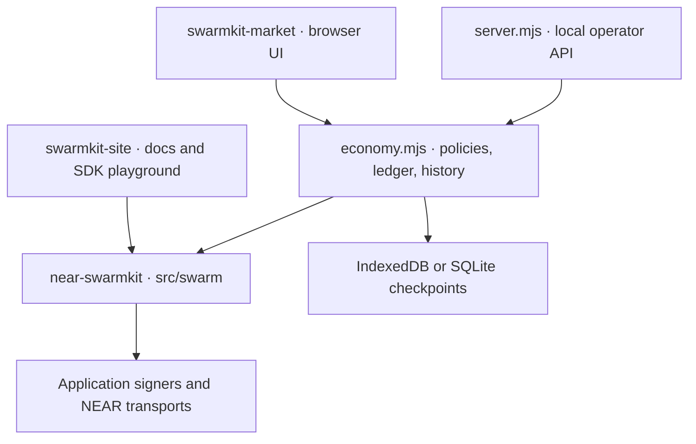

# SwarmKit implementation architecture

SwarmKit is a TypeScript SDK for procurement and agent economies on NEAR. The GPU market is a reference consumer. Scope remains governed by idea.md; the implemented economic rules are in RULES.md. Updated 14 November 2026.



## SDK boundary

`round.ts` owns participants, phases, accepted events and commit/reveal checks. `mechanism.ts` owns the built-in winner and split-allocation rules. `replay.ts` restores transcripts and provides compare-and-set RoundStore operations. `simulation.ts` runs full deterministic rounds; `session.ts` executes asynchronous policies incrementally and explains closed allocations. Simulation sessions contain private offers, so public consumers receive snapshots or transcripts instead.

`settlement.ts` derives versioned plans and receipt summaries. `execute.ts` binds plans, authorizes individual payments and preserves signed bytes across retries. `spending-policy.ts` verifies buyer-signed caps. `near.ts`, `near-testnet.ts` and `near-intents-transport.ts` connect application signers to NEAR. `audit.ts` separates recorded claims from independently observed receipts.

The SDK does not own resource delivery, production identity management, custody, escrow or atomic multi-buyer settlement. Resource delivery windows remain metadata. Applications pin custom mechanism versions, authenticate actors and supply durable storage and trusted signers.

## Reference application

`projects/swarmkit-market/src/economy.mjs` owns multi-round policy state: buyer demand, consumed capacity, external work income, inventory replenishment and seller quote adjustment. `controller.mjs` serializes commands and saves each revision. `browser-store.mjs` uses IndexedDB transactions and Web Locks; `scripts/store.mjs` uses SQLite conditional writes. The browser and local HTTP service execute the same controller with the packaged SDK.

The durable simulated transport stores a prepared transaction before broadcast and persists the simulated sent record before returning. Confirmed payment IDs gate ledger updates. A restart therefore reconciles the same hash instead of paying again. Simulation approvals persist as signatures/public keys; the temporary private signing keys are discarded. These are synthetic approvals, not live credentials.

`scripts/server.mjs` serves the built app and an operator API on loopback. It checks host/origin, authenticates mutations, and keeps SQLite state outside Git. It is a local simulation service. The packaged `examples/agent-service.mjs` is a separate recipe for independent participants: credential-derived identity, buyer/seller roles, bounded HTTP commands and a durable RoundStore. Public deployment still requires the application's identity, TLS and operational controls.

## Execution sequence

```mermaid
sequenceDiagram
  participant A as Agent policies
  participant C as SDK / host
  participant S as Durable state
  participant T as Settlement transport
  A->>C: Demand, commitments, reveals at their stages
  C->>S: Persist private checkpoint after each stage
  C->>C: Clear, replay and derive exact payments
  C->>C: Verify buyer spending approvals
  C->>S: Bind plan and reserve signed payment
  C->>T: Inspect hash; broadcast same bytes if authorized
  T-->>C: Confirmed, failed or pending
  C->>S: Persist receipt and idempotent ledger update
  Note over C,S: A restarted host reads the same checkpoint and journal
```

## NEAR and evidence

The public market is simulation. Recorded native testnet transfers remain separate evidence. The standalone Intents CLI accepts a closed NEP-141 transcript with real participant IDs, supports review/execute/reconcile, and requires funded Verifier balances and buyer/relayer signers. The revised market has not been used for a funded Intents run. Do not convert synthetic credits to a live asset by relabeling a transcript.

The original `src/app` Next.js dashboard remains a minimal SDK example. The standalone Market is the primary reference UI. The site generates API documentation from compiled declarations and ships executable integration examples plus llms-full.txt. Rules and architecture are published as HTML/README content while local planning Markdown remains ignored under the user's existing policy.
