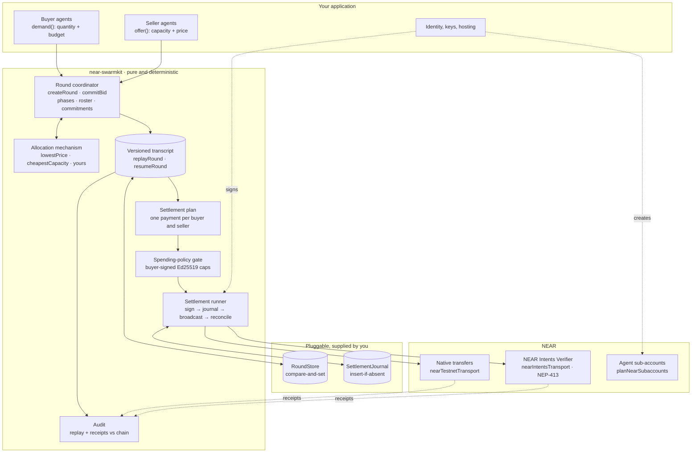
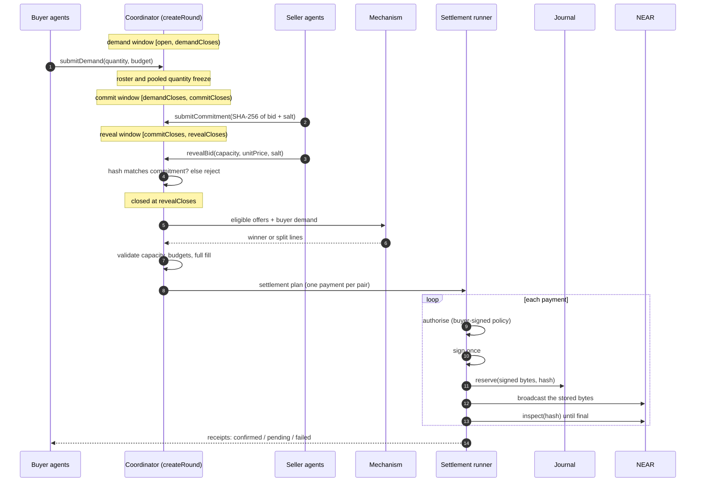
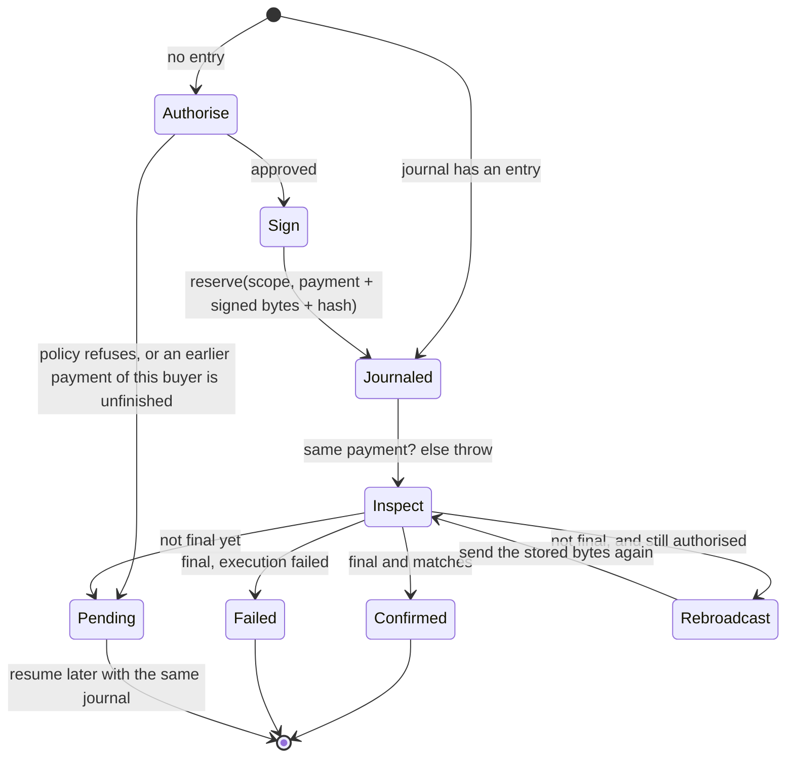

<p align="center">
  <a href="https://swarmkit.pages.dev/"></a>
</p>

<p align="center">
  <a href="https://www.npmjs.com/package/near-swarmkit"></a>
  <a href="#quick-start"></a>
  <a href="#evidence"></a>
  <a href="#evidence"></a>
  <a href="#performance-and-footprint"></a>
  <a href="#testing"></a>
  <a href="#license"></a>
</p>

<p align="center">
  <a href="https://swarmkit-coop.pages.dev/"><b>Live demo: GPU co-op</b></a> ·
  <a href="https://swarmkit.pages.dev/">Website</a> ·
  <a href="https://swarmkit.pages.dev/docs/">Docs</a> ·
  <a href="https://swarmkit.pages.dev/reference/">API reference</a> ·
  <a href="RULES.md">Market rules</a> ·
  <a href="ARCHITECTURE.md">Architecture notes</a> ·
  <a href="https://swarmkit.pages.dev/llms.txt">llms.txt</a>
</p>

---

**SwarmKit is a TypeScript SDK for agent economies on NEAR.** Independent buyer agents pool
their demand, seller agents compete in a sealed-bid round, and SwarmKit clears the pool
within every buyer's budget and every seller's capacity. It then turns the allocation into
one exact payment per buyer and seller, settles each one on NEAR through a crash-safe runner,
and lets anyone replay the round and audit every receipt against the chain.

It is the coordination and settlement layer that every multi-agent marketplace otherwise
rebuilds: **coordination markets, sealed bidding, collective purchasing, intent-based
settlement and repeated economies**, as one dependency-free package of 1,240 lines.

## SwarmKit Exchange: the same rules, enforced on chain

The SDK's market now runs as a NEAR contract ([`contracts/exchange`](contracts/exchange/src/lib.rs)).
Buyers escrow wNEAR. Sellers post bonded sealed bids. **The contract clears with the SDK's own
`cheapest-capacity-v1` rule.** It pays sellers only for delivered units, refunds what was not delivered,
and gives a no-show or short-delivering seller's bond to the buyers it failed. Work rounds add a
three-reviewer panel: two approvals pay the worker, two rejections refund the poster and slash the bond.

| Check | Do | See |
|---|---|---|
| Contract equals the SDK | `cd contracts/exchange && cargo test` | **23 passed**, including `contract_clearing_equals_the_sdk_on_2000_seeded_rounds` (fixtures: `node scripts/differential-fixtures.ts`) |
| Live round, real inference | `node scripts/verify-exchange.mjs exchange.swarmx-6653d3dd2c.testnet` in [swarmkit-market](https://github.com/mikemoulder/swarmkit-market) | **30/30 checks from public RPC.** The on-chain allocation equals the SDK's. 10 buyers, 5 sellers (one never revealed, one delivered half). 16 delivered units, each a NEAR AI Cloud TEE completion with its signature ([evidence](https://github.com/mikemoulder/swarmkit-market/blob/main/public/exchange-testnet.json)). The contract has no keys |
| Mainnet Proof of Round + Intents | `node scripts/mainnet-proof.mjs --verify` in swarmkit-market | **9/9.** Each seller anchored its bid commitment on mainnet from its own account before "sealed". No anchored bid is missing from the transcript. Four buyer-signed payments are final through `execute_intents` on `intents.near` ([1](https://nearblocks.io/txns/GAp51kiGAaJZXuuHjFrCB4tTxPAJj3YRgJNWPH5Uh6B6) · [2](https://nearblocks.io/txns/HkMXUA49FdBC4bSwUHAsfkqF1ACWo7anvzQs7dtksuZk) · [3](https://nearblocks.io/txns/J4G44a3nzwh8CexzcFDh8Xqqms9rHdPdJ8M6ZhKZkb3K) · [4](https://nearblocks.io/txns/J7no2zn7yudvfGnQvTS2ffArRrLU8QckHZCyhdFrDF3h)) |
| Any agent can join | `claude mcp add swarmkit -- node mcp/server.mjs` in swarmkit-market | Tools to list rounds, seal a bid and act in a round. Without a key it returns the exact call to sign |

**What is real and what is not.**
- **On-chain:** the exchange contracts run on testnet, the anchor and the Intents settlement run on mainnet, and the inference is real.
- **Small:** the mainnet amounts are small (0.0034 wNEAR across four payments).
- **Hand-built anchor contract:** the 478-byte anchor contract was written by hand ([`contracts/anchor/build.mjs`](contracts/anchor/build.mjs)) and exercised on a real NEAR VM.
- **Trusted delivery confirmation:** delivery is confirmed by the buyer (or the review panel). The contract stores receipt hashes, while TEE signatures are checked off chain.

## At a glance

| | |
|---|---|
| **What it is** | An SDK: round coordinator, allocation mechanisms, settlement planner, crash-safe settlement runner, NEAR transports, replay and audit |
| **Who it is for** | Developers building agents that buy or sell compute, data, API credits or services, alone or as a swarm |
| **Try it now** | [swarmkit-coop.pages.dev](https://swarmkit-coop.pages.dev): your team's agent joins 19 others to buy GPU hours, and *Settle my share* pays you out on NEAR testnet |
| **On chain** | A real **NEAR Intents settlement on mainnet** through `intents.near` ([transaction](https://nearblocks.io/txns/DHs7dV52LkYyme7mCpKYx7eBERuJN8ZdZiAyoxybAvPE)), plus 24 final NEAR testnet payments, every one independently checked against RPC ([evidence](#evidence)) |
| **Guarantees** | Sealed bids by SHA-256 commitment; no buyer over budget; no seller over capacity; a payment is signed at most once, even across crashes ([guarantees](#guarantees-and-trust-boundaries)) |
| **Footprint** | 0 runtime dependencies · 48 KB of ESM (11 KB gzipped) · a 20-buyer, 5-seller round in about 1.5 ms |
| **Status** | Alpha, built for the 2026 NEAR Hackathon (AI Swarms). Native testnet settlement is live from the demo; NEAR Intents settlement has run on mainnet with a small real payment ([status](#status-and-roadmap)) |

## Contents

1. [Why SwarmKit](#why-swarmkit)
2. [Quick start](#quick-start)
3. [The live demo: a GPU co-op run by agents](#the-live-demo-a-gpu-co-op-run-by-agents)
4. [Architecture](#architecture)
5. [One round, end to end](#one-round-end-to-end)
6. [Protocol specification](#protocol-specification)
7. [Allocation mechanisms](#allocation-mechanisms)
8. [Settlement](#settlement)
9. [NEAR integration](#near-integration)
10. [Replay, storage and audit](#replay-storage-and-audit)
11. [Agents and simulation](#agents-and-simulation)
12. [Guarantees and trust boundaries](#guarantees-and-trust-boundaries)
13. [Evidence](#evidence)
14. [Performance and footprint](#performance-and-footprint)
15. [Testing](#testing)
16. [API reference](#api-reference)
17. [Repository layout](#repository-layout)
18. [Status and roadmap](#status-and-roadmap)
19. [Ecosystem, acknowledgements and licence](#the-swarmkit-ecosystem)

## Why SwarmKit

Agents are starting to spend money on inference, GPU hours, data and each other's services.
One agent buying alone pays the on-demand price. A group of agents can pool demand and make
sellers compete, but only if something answers four hard questions for them:

| Question | Without SwarmKit | With SwarmKit |
|---|---|---|
| Who is in, and when does bidding stop? | Ad-hoc deadlines in each app | A round with a frozen roster, three half-open windows and a monotonic clock |
| Can sellers see each other's prices? | Usually yes, so the auction is not sealed | SHA-256 commitments first, reveals after the commit deadline, mismatches rejected |
| Who owes what? | Hand-rolled splitting, rounding bugs | Exact integer `bigint` arithmetic, one payment per buyer and seller pair, budgets enforced |
| What if the process dies mid-payment? | Pay twice or lose track of money already sent | Sign, journal, then broadcast; on restart, reconcile the stored transaction, never sign again |

The last row is where real funds are lost, and it is the part SwarmKit treats as a protocol,
not an afterthought.

## Quick start

```bash
npm install near-swarmkit
```

Node 22.18 or newer, ESM, with TypeScript declarations included and no runtime dependencies.
To run the reference GPU round and the test suite from source:

```bash
git clone https://github.com/mikemoulder/swarmkit && cd swarmkit
npm ci
npm run demo        # the 20-buyer, 5-seller GPU round
npm test            # 15 tests
```

A complete market in one call. Two buyers pool five units; the cheaper seller cannot cover the
pool, so the second one wins and each buyer pays only for its own units:

```js
import { simulateProcurement } from "near-swarmkit";

const { stages, plan } = await simulateProcurement({
  seed: 42,
  spec: {
    id: "inference-credits-01",
    resource: { label: "Inference credits", unit: "credit", deliveryWindow: "Today" },
    asset: "demo-credits",
    demandCloses: 10, commitCloses: 20, revealCloses: 30,
  },
  buyers: [
    { id: "research", demand: () => ({ quantity: "3", budget: "15" }) },  // 3 credits, spend at most 15
    { id: "indexer",  demand: () => ({ quantity: "2", budget: "10" }) },
  ],
  sellers: [
    { id: "fastlane",  offer: () => ({ capacity: "4", unitPrice: "3" }) }, // cheaper, but too small
    { id: "northstar", offer: () => ({ capacity: "5", unitPrice: "4" }) },
  ],
});

console.log(stages.at(-1).allocation.sellerId);                    // "northstar"
console.log(plan.payments.map(p => [p.buyerId, p.amount]));         // [["research","12"],["indexer","8"]]
```

`stages` holds a snapshot after demand, commitments, reveals and close, so every step of the
auction is inspectable.

## The live demo: a GPU co-op run by agents

**[swarmkit-coop.pages.dev](https://swarmkit-coop.pages.dev)** is the track's own scenario,
told from one team's seat:

1. **You set your agent's order:** GPU hours this week and a budget per hour.
2. **The pool forms.** Your agent joins 19 other small AI teams' agents. Each follows its own
   strategy (deadline-driven, bargain-hunting, steady, patient, price-sensitive) and states why
   it joined, sat out or cut its order.
3. **Five GPU providers bid sealed.** You see their SHA-256 commitments with prices hidden,
   then the reveal. Providers adapt week to week: one undercuts when idle, one prices by
   utilisation, one holds a premium.
4. **SwarmKit clears the pool** within every team's budget. If it cannot, the coordinator
   releases the lowest budget and runs the round again with the same sealed bids, and says so.
5. **You see your saving** against the cheapest on-demand list price, and the settlement plan:
   one payment per team and provider.
6. **Settle my share** pays your share on NEAR testnet through a Cloudflare Worker running the
   SDK's own settlement runner ([a live settlement from the page](https://testnet.nearblocks.io/txns/Dkj33b1AGH72ixhvxTTbXjHfKH7Z5cNV78F2xbXAt2GY)).
7. **Cause a GPU outage** and watch prices rise, low-budget teams get released, and the market
   recover over the following weeks.

Two deeper views sit beside it: a [two-market economy](https://swarmkit-coop.pages.dev/economy.html)
where inference providers buy GPU hours in one SwarmKit market and sell inference in another,
so a GPU shock reaches inference prices purely through agent decisions; and a
[recovery lab](https://swarmkit-coop.pages.dev/lab.html) that breaks settlements on purpose.
Prices in the co-op are simulated dollars; your team and the five providers have real testnet
accounts, and the other 19 teams are simulated.

## Architecture

SwarmKit is layered so that each layer has one job and the economic rules never depend on the
network. Everything above the transports is pure, deterministic TypeScript; everything that
touches a chain is behind the `SettlementTransport` interface.



| Layer | Module | Responsibility | Talks to the network? |
|---|---|---|---|
| Coordinator | `round.ts` | Roster, three deadlines, demand, commitments, reveals, snapshots, transcript | No |
| Mechanism | `mechanism.ts` | Choose a winner or produce split lines; validated by the coordinator | No |
| Simulation | `simulation.ts`, `session.ts` | Seeded strategies, stage-by-stage checkpoints, allocation explanations | No |
| Replay and storage | `replay.ts` | Rebuild a round from its transcript; compare-and-set persistence | No (your store) |
| Settlement plan | `settlement.ts` | Exact payments and stable IDs from a closed round; receipt summaries | No |
| Policy gate | `spending-policy.ts` | Verify buyer-signed spending policies; authorise each payment | No |
| Runner | `execute.ts` | The crash-safe settlement state machine | Through a transport |
| Transports | `near-testnet.ts`, `near-intents-transport.ts`, `near.ts` | Sign, broadcast and verify on NEAR; Intents payloads; sub-account plans | Yes |
| Audit | `audit.ts` | Replay, recompute payments, compare claimed and observed receipts | Through a verifier |

**Design principles.** Amounts are canonical integer strings and all arithmetic is `bigint`,
so nothing rounds. Every input is validated at the boundary and every state transition is
recorded. The SDK never holds keys: signing is a callback your application supplies. And the
economic protocol is independent of TypeScript, so another language can implement the same
transcript and get the same allocation.

## One round, end to end



## Protocol specification

The full economic rules are in [RULES.md](RULES.md). The parts an integrator needs:

**Phases and time.** A round has three deadlines, `demandCloses < commitCloses < revealCloses`,
in whatever unit its clock returns (Unix milliseconds by default, logical ticks in
simulation). Windows are half-open, so a submission at a closing timestamp is late. The clock
must never move backwards; a backwards clock throws.

| Phase | Time window | Accepts | Rules |
|---|---|---|---|
| `demand` | before `demandCloses` | `submitDemand(buyerId, { quantity, budget } \| null)` | Registered buyers only; replace or withdraw freely until the window closes |
| `commit` | `[demandCloses, commitCloses)` | `submitCommitment(sellerId, hash)` | Registered sellers only; one immutable commitment each; 64 hex characters |
| `reveal` | `[commitCloses, revealCloses)` | `revealBid(sellerId, { capacity, unitPrice, salt })` | Must match the seller's commitment; a malformed or mismatched reveal is rejected without using up the seller's chance |
| `closed` | from `revealCloses`, or at `demandCloses` with no demand | — | Snapshot holds bids, rejections, allocation |

**Commitment scheme.** A seller commits to

```text
SHA-256( UTF-8( JSON.stringify(["swarmkit-bid-v1", roundId, sellerId, capacity, unitPrice, salt]) ) )
```

where `capacity` and `unitPrice` are canonical positive integer strings and `salt` is 32 random
bytes as 64 lowercase hex characters. Binding the round and seller IDs into the preimage stops
a commitment being replayed in another round or by another seller. `commitBid()` computes it
with WebCrypto, so it runs in Node, browsers and Workers.

**Validation.** Account IDs follow NEAR's pattern and must be unique across buyers and sellers.
Quantities, budgets, capacities and prices are canonical decimal strings (`"12"`, never `"012"`
or `12`), so two implementations cannot disagree about a number.

**Transcript.** Every accepted command becomes an event, and the transcript is the round's
complete, replayable record:

```json
{
  "version": 1,
  "spec": { "id": "gpu-week-12", "buyers": ["…"], "sellers": ["…"], "asset": "near:testnet:native",
            "resource": { "label": "H100", "unit": "hour", "deliveryWindow": "Week 12" },
            "demandCloses": 10, "commitCloses": 20, "revealCloses": 30, "mechanismId": "cheapest-capacity-v1" },
  "events": [
    { "type": "demand", "at": 1, "buyerId": "lab-orbit", "request": { "quantity": "14", "budget": "84" } },
    { "type": "commitment", "at": 10, "sellerId": "atlas", "hash": "57a2e9…" },
    { "type": "reveal", "at": 20, "sellerId": "atlas", "bid": { "capacity": "40", "unitPrice": "5", "salt": "…" } }
  ],
  "observedAt": 30
}
```

A 20-buyer, 5-seller round is 30 events and about 3.7 KB of JSON.

## Allocation mechanisms

A mechanism is a pure function from eligible offers (and, for split rules, buyer demand) to a
decision. The coordinator filters and validates around it, so a buggy or hostile mechanism
cannot overcharge a buyer or oversell a seller.

**`lowestPrice` (`lowest-price-v1`), single winner.** An offer is eligible only if its
capacity covers the whole pool *and* every buyer's share at that price fits the buyer's
budget; otherwise it is marked `insufficient-capacity` or `buyer-budget`. The cheapest
eligible unit price wins, ties broken by ascending ASCII seller ID. Every buyer pays
`quantity × winning price`.

**`cheapestCapacity` (`cheapest-capacity-v1`), split fulfilment.** For pools no single
seller can fill:

```text
inventory ← offers sorted by unit price, then seller ID
buyers    ← sorted by budget per unit, tightest first (exact cross-multiplication, then buyer ID)
for each buyer:
    take units from the cheapest remaining inventory until the buyer's quantity is filled
    if the buyer is not fully filled, or its spend exceeds its budget: return null (no sale)
return fulfilment lines (buyer, seller, quantity)
```

Serving the tightest budgets first gives the most constrained buyers the cheapest capacity.
It runs in O(B log B + S log S + B·S) for B buyers and S sellers. It is a deterministic greedy
heuristic: `null` means this rule found no allocation, not that none exists.

**Your own rule.** Implement either interface, give it a versioned ID, and pass it to the
coordinator, replay and audit:

```ts
type ProcurementMechanism = { id: string } & (
  | { selectWinner(offers: EligibleOffer[]): string | null }                       // one seller
  | { allocate(buyers: Buyer[], offers: EligibleOffer[]): FulfillmentLine[] | null } // split lines
);
```

For split rules the coordinator recomputes every amount at the seller's revealed price and
rejects lines that overfill a buyer, exceed a seller's capacity, exceed a buyer's total budget,
repeat a buyer–seller pair, or leave any buyer unfilled. A custom rule chooses *who*; it can
never choose *what anyone pays*. The transcript records the mechanism ID, and replay refuses a
round whose rule does not match, so a rule cannot be swapped under an old round.

## Settlement

**Plans.** `createSettlementPlan(snapshot)` turns a closed round into payments with stable IDs:

| Plan | When | Payment ID |
|---|---|---|
| Version 1 | Single winner | `JSON.stringify([roundId, buyerId])` |
| Version 2 | Split fulfilment | `JSON.stringify([roundId, buyerId, sellerId])` |

**The runner** (`executeSettlement`) is the heart of SwarmKit's safety. For each payment:



The invariants that make it crash-safe:

1. **Sign at most once per payment.** A payment is signed only when the journal has no entry
   for it, and the signed bytes are stored *before* any broadcast.
2. **Resume by reconciling, never re-signing.** After a crash, the runner finds the stored
   entry, inspects the stored hash and rebroadcasts only those exact bytes.
3. **No silent edits.** An entry whose amount, buyer or seller differs from the plan under the
   same payment ID throws instead of paying.
4. **Locked schedules for split plans.** Version 2 plans are bound to the journal by an atomic
   `bindPlan(scope, fingerprint)`, so a retry cannot settle a different split.
5. **Ordered per buyer.** A buyer's next payment waits until its previous one is confirmed.
6. **Authorised twice.** The policy is checked before signing and again before broadcasting.

The journal is two functions you implement on any durable store:

```ts
type SettlementJournal = {
  read(scope: string): Promise<SettlementEntry | undefined>;
  reserve(scope: string, candidate: SettlementEntry): Promise<SettlementEntry>; // insert-if-absent, return the stored entry
  bindPlan?(scope: string, fingerprint: string): Promise<boolean>;               // required for split plans
};
```

The repository ships journals on the filesystem (atomic `link`-based insert) and in Cloudflare
Workers KV, and the market keeps its journal in IndexedDB or SQLite checkpoints. Journal entries contain broadcastable signed transactions, so keep
them private.

**Spending policies.** A buyer limits what an agent can spend on its behalf by signing, with
its Ed25519 key, the UTF-8 bytes of

```text
["swarmkit-spending-policy-v1", roundId, buyerId, asset, transportScope, [sellers…sorted], maxAmount, expiresAt]
```

`executeWithSpendingPolicies` verifies each signature with WebCrypto against a key *you*
resolve (never one the agent supplies), and then authorises a payment only if its ID, buyer,
seller and amount match the plan, every seller the buyer pays is on its allowlist, the
buyer's total is within `maxAmount`, and the policy has not expired.

## NEAR integration

**One account per agent.** `planNearSubaccounts(parent, agents)` validates labels and keys and
returns, for each agent, the exact `CreateAccount`, `Transfer` and `AddFullAccessKey` actions for
`label.parent`. Keys must be unique per agent, funding is bounded to 2¹²⁸ − 1 yoctoNEAR, and
the parent must be a named `.near` or `.testnet` account. Your application signs with the
parent.

**Native NEAR (`nearTestnetTransport`).** You supply a signer that builds exactly the approved
transfer. The transport broadcasts with `send_tx`, then accepts a payment as *confirmed* only
when the transaction is `FINAL` **and** its signer is the buyer, its receiver is the seller, it
has exactly one action, and that action is a `Transfer` of exactly the planned amount.
Anything else is a mismatch, not a success.

**NEAR Intents (`nearIntentsTransport`).** For balances held in the Intents Verifier
(`intents.near`), each payment becomes a NEP-413 signed transfer intent:

```json
{ "signer_id": "<buyer>", "deadline": "<now + 5 min>",
  "intents": [{ "intent": "transfer", "receiver_id": "<seller>",
                "tokens": { "nep141:wrap.near": "<amount>" }, "memo": "<payment id>" }] }
```

The 32-byte nonce embeds the Verifier's `current_salt`, read live. Before anything is signed by
the relayer, the transport **preflights** the batch with `simulate_intents` and requires
exactly one executed intent and no invariant violation. Execution is a single `execute_intents`
call with zero deposit, and reconciliation decodes the finalised call and checks the relayer,
the receiver, the buyer, the seller, the token, the amount and the memo.

**It has settled on mainnet.** A sealed SwarmKit round, one buyer agent buying one GPU hour from a
seller agent, settled through `intents.near` for 0.001 wNEAR: the signed NEP-413 intent was
preflighted with `simulate_intents`, journaled, executed by the buyer's relayer, and reconciled by
the SDK as `confirmed`; the audit matched and the Verifier balances moved by exactly the planned
amount ([transaction](https://nearblocks.io/txns/DHs7dV52LkYyme7mCpKYx7eBERuJN8ZdZiAyoxybAvPE), [round, plan and receipt](https://swarmkit-coop.pages.dev/intents-mainnet.json)).
Both agents are NEAR implicit accounts, whose own keys the Verifier recognises without registration.

## Replay, storage and audit

**Replay.** `replayRound(transcript, mechanism)` re-applies every event under the recorded
times and recomputes the snapshot; it rejects out-of-order times, events after the
observation time, and any event the coordinator would have refused. `resumeRound` reopens a
live round from its transcript, and `settlementPlanFromTranscript` derives payments directly.

**Storage.** For a coordinator shared by many agents, persist through a `RoundStore`:

```ts
type RoundStore = {
  read(roundId: string): Promise<RoundTranscript | undefined>;
  compareAndSet(next: RoundTranscript, expectedRevision: number | null): Promise<boolean>; // revision = event count
};
```

`submitStoredRoundEvent` resumes the round, applies one command and saves only if no one else
wrote first, returning `accepted`, `rejected` or `conflict`. Two coordinators cannot both
accept conflicting commands. A SQLite store and an authenticated HTTP agent service are in
[`examples/`](examples).

**Audit.** `auditSettlement(transcript, claims, { verifier })` replays the round, recomputes
the plan, rejects a transaction hash reused across payments, requires a hash for every final
claim, and inspects each one on chain. It returns the claimed and the verified summaries side
by side, with a per-payment `matches` flag. From the command line:

```bash
npm run audit -- evidence.json --verify-testnet
```

## Agents and simulation

A strategy is a plain async function, so an agent can be a script, a rules engine or a language
model behind the same interface:

```ts
type BuyerStrategy  = { id: string; demand(ctx): Demand | null | Promise<Demand | null> };
type SellerStrategy = { id: string; offer(ctx & { pooledQuantity: string }): Omit<Bid, "salt"> | null | Promise<…> };
```

`simulateProcurement` runs a whole round with a seeded generator, so the same seed always
produces the same transcript. `startSimulation` and `advanceSimulation` run **one stage per
call** and return a serialisable checkpoint, so a long-running swarm can persist between
stages and survive restarts. Checkpoints hold unrevealed bids and must stay private; publish
the transcript instead. `explainAllocation(snapshot)` reports each buyer's spend, unused budget
and fulfilment lines, and each seller's allocation or rejection reason.

<details>
<summary><b>Run a round step by step and resume it after a restart</b></summary>

```js
import { startSimulation, advanceSimulation, replayRound } from "near-swarmkit";

let session = startSimulation(agents);
session = await advanceSimulation(session, agents);   // demand, then commit, reveal, close
await save(JSON.stringify(session));                  // private: holds unrevealed bids
// ...after a restart
session = await advanceSimulation(JSON.parse(await load()), agents);
const snapshot = await replayRound(session.transcript);
```
</details>

<details>
<summary><b>Split one order across several sellers</b></summary>

```js
import { cheapestCapacity, createRound } from "near-swarmkit";

const round = createRound({ ...spec, mechanismId: cheapestCapacity.id });
```
</details>

<details>
<summary><b>Pay on NEAR testnet, within limits each buyer signed</b></summary>

```js
import { executeWithSpendingPolicies, nearTestnetTransport, spendingPolicyMessage } from "near-swarmkit";

const transport = nearTestnetTransport(signPayment);  // your signer builds exactly this transfer
const policy = {
  roundId: plan.roundId, buyerId, asset: plan.asset, transportScope: transport.scope,
  sellers: ["seller-2.example.testnet"], maxAmount: "4000000000000000000000",  // 0.004 NEAR
  expiresAt: Date.now() + 10 * 60_000,
};
const signature = new Uint8Array(
  await crypto.subtle.sign("Ed25519", buyerPrivateKey, spendingPolicyMessage(policy)));

await executeWithSpendingPolicies(plan, {
  transport, journal, approvals: [{ policy, signature }], resolveBuyerKey,
});
```

[`examples/testnet-settlement.mjs`](examples/testnet-settlement.mjs) runs the whole flow from
faucet-funded accounts; add `--gpu` or `--split` for the runs in [Evidence](#evidence).
</details>

## Guarantees and trust boundaries

| SwarmKit enforces | Your application owns | Not provided (yet) |
|---|---|---|
| Phase windows and a monotonic clock | Authenticating agents before their commands reach the coordinator | Escrow or atomic settlement across all buyers |
| One immutable commitment per seller; reveals must match | Keeping signing keys and journals private | Refunds after a confirmed transfer |
| No buyer over budget, no seller over capacity, every buyer filled exactly | Durable, atomic `RoundStore` and `SettlementJournal` | Verifying delivery of the purchased resource |
| Exact integer amounts and stable payment IDs | Pinning custom mechanism implementations to their IDs | An on-chain coordinator contract |
| Sign at most once per payment; reconcile instead of re-signing | Funding accounts and choosing networks | A production identity service |
| Buyer-signed spending caps checked twice | Hosting the coordinator | Python bindings |
| Receipts accepted only when the finalised transaction matches the plan | | |

**What replay proves, and what it does not.** A transcript is internally consistent: every
event was legal when recorded and the allocation follows from it. It cannot prove that no
submission was left out. The coordinator is therefore a trusted service today; commitments
bind sellers to their bids, but they do not prove the coordinator admitted every bid. An
on-chain commitment log is the natural next step ([roadmap](#status-and-roadmap)).

## Evidence

Every number here can be rechecked against NEAR RPC.

| Run | Agents | Payments | Total | How it was checked |
|---|---|---:|---:|---|
| GPU round, one winning seller | 20 buyers, 5 sellers, one sub-account each | **20 of 20** final | 0.036 NEAR | Interrupted after the first signed payment was journaled, resumed from the journal, then independently audited ([records](https://swarmkit-coop.pages.dev/gpu-testnet.json), [first transfer](https://testnet.nearblocks.io/txns/9ov59i19duUyDkwcXNn5nTY7vwvJV3cVXpQoRSCeyx4s)) |
| Split order across two sellers | 1 buyer, 2 sellers | **2 of 2** final | 0.0014 NEAR | Same interruption and audit ([records](https://swarmkit-coop.pages.dev/split-testnet.json), [seller 1](https://testnet.nearblocks.io/txns/5fo7YBXAhgM5Ar7sGEQgohDoQeZHzrwpFJUeVfbLp9fY), [seller 2](https://testnet.nearblocks.io/txns/45diCCuBhfCzxMrbJUxfNwagrQa8ntkmgw63cKQ4S5Di)) |
| **NEAR Intents on mainnet** | 1 buyer agent, 1 seller agent (implicit accounts) | **1 of 1** final | 0.001 wNEAR | Preflighted with `simulate_intents`, executed via `execute_intents`, reconciled by the SDK as `confirmed`, audit matched; Verifier balances 0.01 → 0.009 and 0 → 0.001 ([transaction](https://nearblocks.io/txns/DHs7dV52LkYyme7mCpKYx7eBERuJN8ZdZiAyoxybAvPE), [records](https://swarmkit-coop.pages.dev/intents-mainnet.json)) |
| Live co-op, settled from the public page | your team → a provider | **2** final | 0.0147 NEAR | The same request sent twice returned one transaction ([idempotency check](https://testnet.nearblocks.io/txns/HNTQrBPj7YrAeZSinCncvtUrP8i7RAoSyDRF5GhLLTos), [page click](https://testnet.nearblocks.io/txns/Dkj33b1AGH72ixhvxTTbXjHfKH7Z5cNV78F2xbXAt2GY)) |

The 20-buyer round, bid by bid. Twenty buyers pool 90 GPU hours, each capped at 7 credits an
hour:

| Seller | Price | Hours | Outcome |
|---|---:|---:|---|
| seller-1 | 2 | 89 | Rejected: one hour short of the pool |
| seller-2 | **4** | 90 | **Winner** |
| seller-3 | 6 | 90 | Eligible, more expensive |
| seller-4 | 8 | 90 | Rejected: above every buyer's cap |
| seller-5 | 10 | 90 | Rejected: above every buyer's cap |

The pool clears at 4 an hour, 360 in total, each buyer paying only for its own hours. Run it
with `npm run demo`. In the market's
[recovery lab](https://swarmkit-coop.pages.dev/lab.html) GPU cooperative, the first round buys
59 hours for **177 credits pooled, against 236** bought alone from the same sellers.

## Performance and footprint

Measured on Node 22.18 on a developer laptop, averaging 300 rounds:

| Measure | Result |
|---|---:|
| Full sealed round, 20 buyers × 5 sellers, including 5 SHA-256 commitments and their verification | **≈ 1.5 ms** |
| Replaying that round from its transcript | **< 1 ms** |
| Transcript size | ≈ 3.7 KB, 30 events |
| Package size | 48 KB of ESM, **11 KB gzipped** |
| Runtime dependencies | **0** |
| Source | 1,240 lines of TypeScript across 14 modules |
| Runs on | Node 22.18+, modern browsers and Cloudflare Workers (WebCrypto only) |

The coordinator is never the bottleneck; NEAR finality is.

## Testing

| Suite | Tests | What it proves |
|---|---:|---|
| Core SDK (`npm test`) | 15 | A deterministic GPU round paying exact shares within caps; immutable commitments, correctable mismatched reveals and account-ID tie-breaks; split fulfilment under a cumulative signed cap; a stored round surviving restart and detecting conflicting writes; an ambiguous broadcast resumed from the journal **without signing a replacement**; buyer signatures gating amount, transport and expiry; audit separating claims from observed receipts and rejecting reused hashes; Intents preflight before signing and exact reconciliation; one distinct key per sub-account; checkpointed async strategies; credential-derived identities in the agent service |
| Market (`swarmkit-market`) | 17 | A child process **killed right after a broadcast is recorded** recovers without paying twice; 12 rounds conserve every credit and unit; the co-op never exceeds a budget and fills every served team exactly; outages release the lowest budgets and the market recovers; every week replays from its SDK transcript to the same allocation |
| On chain | 25 payments | Interrupted-and-resumed testnet settlement, then independent RPC audit; live settlement from the public page with an idempotency check; a NEAR Intents settlement on mainnet reconciled and audited by the SDK |

## API reference

Generated from the package's declarations at
[swarmkit.pages.dev/reference](https://swarmkit.pages.dev/reference/). The public surface:

| Area | Exports |
|---|---|
| Rounds | `createRound`, `commitBid` · types `RoundSpec`, `Demand`, `Bid`, `Allocation`, `RoundSnapshot`, `RoundCommand`, `RoundEvent`, `RoundTranscript` |
| Mechanisms | `lowestPrice`, `cheapestCapacity` · types `ProcurementMechanism`, `EligibleOffer`, `FulfillmentLine`, `SplitAllocation` |
| Replay and storage | `replayRound`, `resumeRound`, `settlementPlanFromTranscript`, `openStoredRound`, `submitStoredRoundEvent` · type `RoundStore` |
| Simulation | `simulateProcurement`, `startSimulation`, `advanceSimulation`, `explainAllocation` · types `BuyerStrategy`, `SellerStrategy`, `SimulationOptions`, `SimulationSession` |
| Settlement | `createSettlementPlan`, `summarizeSettlement`, `executeSettlement` · types `SettlementPlan`, `Payment`, `PaymentReceipt`, `SettlementJournal`, `SettlementTransport`, `SignedPayment`, `SettlementEntry` |
| Spending policies | `spendingPolicyMessage`, `authorizeWithSpendingPolicies`, `executeWithSpendingPolicies` · type `SpendingPolicy` |
| NEAR | `planNearSubaccounts`, `nearTestnetTransport`, `NATIVE_TESTNET_NEAR`, `nearIntentsTransport`, `INTENTS_VERIFIER`, `prepareNearIntentsTransfers`, `signNearIntentsTransfers`, `nearIntentsExecutionCall`, `readNearIntentsSalt` · type `NearIntentSigningRequest` |
| Audit | `auditSettlement` · type `ReceiptClaim` |

## Repository layout

```text
src/swarm/                 the SDK (published as near-swarmkit)
  round.ts                 coordinator: phases, commitments, reveals, snapshots, transcripts
  mechanism.ts             lowestPrice, cheapestCapacity, split validation
  simulation.ts            seeded whole-round simulation
  session.ts               stage-by-stage checkpoints, explainAllocation
  replay.ts                replay, resume, RoundStore compare-and-set
  settlement.ts            plans, payment IDs, receipt summaries
  execute.ts               the crash-safe settlement runner
  spending-policy.ts       Ed25519 buyer policies
  near-testnet.ts          native NEAR transport
  near-intents-transport.ts, near.ts   NEAR Intents (NEP-413), sub-account plans
  audit.ts                 replay + receipt verification
examples/                  split market, incremental market, SQLite store, agent HTTP service, testnet settlement
scripts/                   demo, audit CLI, SDK packaging, live Intents probe
test/                      the core test suite
RULES.md · ARCHITECTURE.md the economic rules and the system boundaries
```

## Status and roadmap

SwarmKit is **alpha**: built for the 2026 NEAR Hackathon, AI Swarms track; tested hard; not
audited. Use testnet.

- **Real and tested:** everything in [Evidence](#evidence) and [Testing](#testing). Native
  NEAR testnet settlement runs live, including from the public demo.
- **NEAR Intents:** settled on mainnet once, with a deliberately small real payment (0.001
  wNEAR) between two agent accounts, and verified end to end. The demo's interactive settle
  button uses native testnet transfers, because no Intents Verifier is deployed on testnet.
- **Known limitations:** the coordinator is a trusted off-chain service; settlement is per
  buyer, not atomic across the pool; no refunds or delivery checks; `cheapestCapacity` is a
  greedy heuristic.
- **Next:** Intents settlement from the co-op itself for funded agents; an on-chain commitment log
  so anyone can prove a round admitted every bid; more mechanisms (uniform-price and Vickrey
  clearing); Python bindings over the same transcript format.

## The SwarmKit ecosystem

| Project | What it is |
|---|---|
| [**SwarmKit GPU Co-op**](https://swarmkit-coop.pages.dev/) ([source](https://github.com/mikemoulder/swarmkit-market)) | The live demo: your agent buys GPU hours with 19 others and settles its share on NEAR testnet; plus the two-market economy and the recovery lab |
| [**Website and docs**](https://swarmkit.pages.dev/) ([source](https://github.com/mikemoulder/swarmkit-site)) | Quick start, guides, generated API reference, and the SDK running in the page |
| [**llms.txt**](https://swarmkit.pages.dev/llms.txt) · [**llms-full.txt**](https://swarmkit.pages.dev/llms-full.txt) | The docs as plain text for language models and coding agents |
| [**Agent HTTP service**](examples/agent-service.mjs) · [**SQLite round store**](examples/sqlite-round-store.mjs) | Integration recipes for a durable, authenticated coordinator |

## Develop

```bash
npm ci
npm test                         # core tests
npm run demo -- api-credits      # other scenarios: api-credits, no-sale
npm run build:sdk                # compile the package into dist/sdk
npm run dev                      # the original minimal dashboard on http://localhost:3000
```

The [scripts README](scripts/README.md) lists every script. Working notes for contributors and
coding agents are in [AGENTS.md](AGENTS.md).

## Acknowledgements

- The [NEAR AI Swarms starter prompt](https://github.com/nearai/near-hackathon-prompt-examples/blob/main/tracks/05-swarms.md)
  describes the group-buying swarm that SwarmKit's reference round and the GPU co-op implement.
- [NEAR Intents](https://docs.near-intents.org/) and its Verifier contract provide the
  intent-based settlement path.

## License

Licensed under either of [Apache License 2.0](LICENSE-APACHE) or [MIT](LICENSE-MIT), at your
option.
