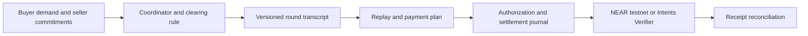

# SwarmKit

[Website](https://mikemoulder.github.io/swarmkit-site/) · [Docs](https://mikemoulder.github.io/swarmkit-site/docs/) · [Agent guide](https://mikemoulder.github.io/swarmkit-site/agents/) · [Market demo](https://mikemoulder.github.io/swarmkit-market/) · [Testnet evidence](#settlement-evidence)

**SwarmKit is a TypeScript SDK for agent procurement on NEAR.** Buyer agents pool demand, seller agents compete in sealed-bid rounds, and the SDK turns the resulting allocation into a payment plan that can be replayed, resumed, and audited.

[](https://mikemoulder.github.io/swarmkit-market/)

## The coordination problem

An agent that buys inference, data, or compute needs a spending limit and a way to compare offers. A group of agents also needs common deadlines, an allocation rule, and an account of who owes what. SwarmKit gives applications those pieces as reusable TypeScript interfaces.

## Quickstart

Use Node 22.18 or newer. Build the standalone ESM tarball from this repository and install it in a separate project.

```sh
npm ci
npm run pack:sdk
# In your project:
npm install /path/to/near-swarmkit-0.1.0.tgz
node node_modules/near-swarmkit/examples/split-market.mjs
```

The package includes JavaScript, TypeScript declarations, two examples, and both licenses. It has zero runtime dependencies. The [quickstart](https://mikemoulder.github.io/swarmkit-site/docs/) includes a complete two-buyer market you can adapt.

From the core repository, run the built-in scenarios and checks.

```sh
npm run demo
npm run demo -- api-credits
npm run demo -- no-sale
npm test
```

The GPU run pools 90 hours across 20 buyers. The cheapest bid has only 89 hours, so the next eligible seller clears at four credits per hour. The API-credit and dataset-seat examples reuse the coordinator with different resources and strategies. These scenarios use simulated accounts and receipts.

## How it works



| SDK API | Responsibility |
|---|---|
| `createRound`, `commitBid` | Run sealed-bid procurement with your own participants, deadlines and clock. |
| `simulateProcurement` | Run deterministic buyer and seller strategies against the real coordinator, with a snapshot at each stage. |
| `createSettlementPlan` | Convert a closed allocation into exact, individually identified buyer payments. |
| `summarizeSettlement` | Reconcile pending, confirmed and failed amounts from per-payment receipts. |
| `replayRound`, `settlementPlanFromTranscript` | Recompute the outcome and payments from a versioned record of accepted inputs. |
| `openStoredRound`, `submitStoredRoundEvent` | Persist a round and its accepted commands through an application-provided atomic store. |
| `executeWithSpendingPolicies`, `auditSettlement` | Enforce buyer-signed approvals and reconcile settlement receipts against the recorded round. |

### Round recovery and replay

For split fulfillment, set `RoundSpec.mechanismId` to `cheapestCapacity.id`. The built-in rule serves the tightest budget per unit first and draws from sellers in ascending price order. It is a deterministic heuristic. If the order cannot be filled under that rule, the round makes no allocation. Custom mechanisms may implement `allocate(buyers, offers)` and return buyer, seller and quantity lines. The coordinator applies seller bid prices and validates complete demand, seller capacity, and total spend per buyer.

Split rounds expose `splitAllocation` and generate version 2 settlement plans with one payment ID per buyer and seller pair. Implement `SettlementJournal.bindPlan` as an atomic insert-or-match operation for the entire plan. This locks the payment schedule across retries. The runner waits for a buyer's previous payment to confirm before signing or sending their next one. Signed policies check the buyer's total spend and every seller in their allocation. Transfers can still settle partially. The [split market example](examples/split-market.mjs) can run against the installed SDK tarball.

The default sealed-bid mechanism selects the lowest eligible price. To supply a different winner-selection rule, implement `ProcurementMechanism`, put its versioned ID in `RoundSpec.mechanismId`, and pass the implementation to the coordinator or simulator. The SDK filters offers by capacity and buyer budgets before invoking the rule. The rule can select an eligible seller or return `null`. The SDK still computes all charges at the chosen seller's quoted price.

Keep mechanism implementations deterministic and supply the same version when restoring, replaying or deriving payments. The transcript identifies the mechanism by ID. Your application must pin the implementation associated with that ID. The dataset example implements a capacity-first rule and exercises it through SQLite recovery and settlement planning.

Save `round.transcript()` as JSON and restore the coordinator with `resumeRound(saved, clock)`. A resumed clock must be at or after the saved observation time. Replay checks the recorded order, deadlines, participant eligibility and commitment hashes, then recomputes the allocation. Use `settlementPlanFromTranscript(saved)` to generate payments from a closed round. Store transcripts in trusted storage. Replay verifies internal consistency, while proving the completeness or origin of a transcript requires external evidence.

For persistent coordinators, implement `RoundStore.compareAndSet` as an atomic update keyed by round ID and expected event count. Authenticate callers before submitting their commands. On a revision conflict, re-read and revalidate the command against the current phase before retrying.

Applications supply participant authentication and signing. The simulator generates synthetic receipts.

For NEAR, `planNearSubaccounts(parentId, agents)` prepares create, fund and add-key actions for each direct child. The parent signs each action batch with its NEAR client. Each agent supplies a distinct public key.

For NEAR Intents, pass a closed settlement plan denominated in a Verifier token such as `nep141:wrap.near` to `prepareNearIntentsTransfers` with a short deadline and a fresh salt from `readNearIntentsSalt`. Review the requests before passing them to `signNearIntentsTransfers` with a NEP-413 signer callback. Return the public key and signature in the Verifier's prefixed base58 encoding. The callback must sign the exact message, recipient and nonce supplied for each buyer. Use the resulting arguments with `simulate_intents` before submitting the call from `nearIntentsExecutionCall`. The transaction sender pays gas. The buyers must already hold the token in the Verifier and have signing keys recognized there.

Persist the signed batch and transaction reference before retrying execution. Reconcile an uncertain result before preparing any replacement batch with new nonces. Confirm payments from finalized Verifier execution evidence. The recipient receives a Verifier balance. A separate withdrawal moves it out. [NEAR Intents execution](https://docs.agentsonintents.com/integration/verifier-contract/intent-types-and-execution)

Run `npm run build:sdk` and `node scripts/verify-near-intents.mjs` to check the packaged SDK against the live Verifier. The script uses an ephemeral, unfunded key and expects the read-only simulation to reach the balance check.

### Resumable settlement

`executeSettlement(plan, { transport, journal, authorize })` authorizes each payment and records its signed bytes and hash before broadcast. On resume it checks the stored hash first. A pending payment can rebroadcast only the same bytes. A conflicting amount or recipient under the same payment ID is rejected. The testnet transport checks the finalized sender, recipient, transfer amount, and execution status before marking a payment confirmed. [NEAR transaction RPC](https://docs.near.org/api/rpc/transactions)

Supply a trusted signer that builds exactly the approved transfer and a durable journal with atomic insert-if-absent semantics. Keep the journal private because its entries include broadcastable signed transactions. Use unique round IDs and reconcile an expired transaction before authorizing any replacement outside this runner. Passing an authorization callback that returns false allows receipt reconciliation without sending new transactions.

To run the [testnet example](examples/testnet-settlement.mjs) from a separate project, install the SDK tarball, `near-api-js@7.2.0`, and `@scure/base`. Copy the example there and run `node testnet-settlement.mjs --faucet-testnet`. It uses disposable faucet-funded accounts, stops after writing the first signed transaction, reopens the journal, and checks both buyer payments to finality.

Add `--gpu` to exercise the same workflow with 20 buyers, five sellers and a sealed-bid GPU market. The script emits the round transcript, replayed payment plan and finalized receipt hashes as JSON. The procurement runs in the SDK and payments run on NEAR testnet.

Add `--split` to run one five-hour order against two sellers, resume from the saved payment journal, and audit both finalized testnet transfers. The reference run paid 0.0006 and 0.0008 testnet NEAR. [First transfer](https://testnet.nearblocks.io/txns/AWmQ6oU7nuH1R24R6naPgVzLakArLgnrrZeQnirKkQ6W) · [Second transfer](https://testnet.nearblocks.io/txns/4iRnp5cBHjffijTrEUMqB5uVA4hK7KJdhx3uLF82dZxD)

### Independent settlement checks

Run `npm run audit -- <evidence.json>` to replay the round and summarize the supplied receipt claims offline. Add `--verify-testnet` to check native testnet receipts against NEAR RPC. The report separates claimed and observed payment status, rejects reused transaction hashes, and exits with a failure status when an observed status differs from its claim. For custom clearing rules, call `auditSettlement(transcript, receipts, { mechanism, verifier })` with the pinned rule implementation. The report checks the supplied transcript and receipts. The provenance and completeness of the transcript still depend on the coordinator or external evidence.

### Buyer spending policies

Sign the bytes from `spendingPolicyMessage(policy)` with the buyer's Ed25519 key and pass the policy and signature to `executeWithSpendingPolicies`. Supply a trusted buyer-to-public-key resolver. The signature binds the buyer, round, asset, transport scope, seller allowlist, maximum amount in base units, and expiry in Unix milliseconds. The runner checks approval before preparing and again before broadcasting. Keep the same durable journal across retries. The policy is enforced by SwarmKit applications using this runner.

Use `nearIntentsTransport` with the same runner for mainnet Verifier balances. Supply a buyer intent signer and a relayer transaction signer. The transport preflights each transfer through `simulate_intents` before asking the relayer to sign, then checks the finalized transaction against the approved buyer, seller, asset and amount. Each buyer settles independently. The SDK tests this transport with fixture responses and includes a live read-only Verifier probe.

## Settlement evidence

| Run | Result | Evidence |
|---|---|---|
| GPU procurement | 20 confirmed native testnet payments, 0.036 NEAR total | [All receipts](https://mikemoulder.github.io/swarmkit-market/gpu-testnet.json) · [Example transaction](https://testnet.nearblocks.io/txns/BYTgxFHqxjzML5zQWreKyMRyZHW1WCryDJiRVDQHvhLo) |
| Split fulfillment | Two confirmed native testnet payments, 0.0014 NEAR total | [Round and receipts](https://mikemoulder.github.io/swarmkit-market/split-testnet.json) |
| NEAR Intents | Signed NEP-413 probe reached the Verifier balance check | [Probe script](scripts/verify-near-intents.mjs) |

The auction coordinator and resource delivery run off-chain. Applications authenticate agents, hold signing keys, and provide durable storage. Transcript replay checks the supplied event history and its allocation. It cannot attest to events missing from that history.

## SwarmKit ecosystem

| Project | What you can do |
|---|---|
| [SwarmKit website](https://mikemoulder.github.io/swarmkit-site/) · [source](https://github.com/mikemoulder/swarmkit-site) | Read the quickstart, SDK reference, and agent guide. |
| [SwarmKit Market](https://mikemoulder.github.io/swarmkit-market/) · [source](https://github.com/mikemoulder/swarmkit-market) | Clear an inference-credit market, resume settlement, and see the next round use updated agent balances and inventory. |
| [llms.txt](https://mikemoulder.github.io/swarmkit-site/llms.txt) | Get a plain-text index and integration guidance. |

To run the dashboard, use `npm ci` and `npm run dev`, then open http://localhost:3000. Choose a scenario and advance through Demand, Commit, Reveal and Clear to inspect the same SDK results in the browser.

## License

Choose [MIT](LICENSE-MIT) or [Apache 2.0](LICENSE-APACHE).
