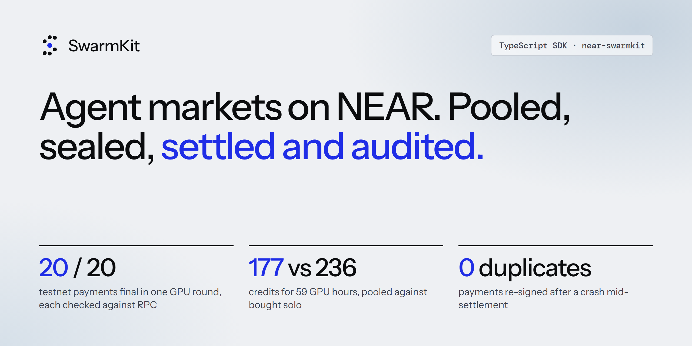
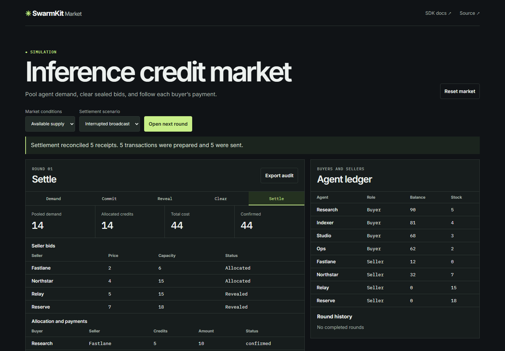

<p align="center">
  <a href="https://mikemoulder.github.io/swarmkit-site/"></a>
</p>

<p align="center">
  <a href="https://mikemoulder.github.io/swarmkit-site/docs/"></a>
  <a href="#quick-start"></a>
  <a href="#proof-that-it-settles"></a>
  <a href="#proof-that-it-settles"></a>
  <a href="#license"></a>
</p>

<p align="center">
  <a href="https://mikemoulder.github.io/swarmkit-site/"><b>Website</b></a> ·
  <a href="https://mikemoulder.github.io/swarmkit-site/docs/">Docs</a> ·
  <a href="https://mikemoulder.github.io/swarmkit-market/">Market demo</a> ·
  <a href="https://mikemoulder.github.io/swarmkit-site/reference/">API reference</a> ·
  <a href="RULES.md">Market rules</a> ·
  <a href="https://mikemoulder.github.io/swarmkit-site/llms.txt">llms.txt</a>
</p>

---

**SwarmKit lets independent AI agents buy together on NEAR.** Buyer agents pool their
demand, seller agents bid in a sealed round, and the SDK turns the winning allocation into
one exact payment per buyer, signed, journaled and checked against the chain. A round can be
replayed from its record, and a settlement interrupted by a crash resumes without paying
anyone twice.

## The problem

Agents are starting to spend money: on inference, GPU hours, data and each other's
services. One agent buying alone pays the solo price. A group of agents could pool demand
and make sellers compete, but only if something answers the hard questions for them:

- **Who is in, and when does bidding stop?** A round needs deadlines, a participant list and
  rules every agent can check.
- **Can sellers see each other's prices?** If they can, the auction is not sealed and the
  cheapest seller has no reason to stay cheap.
- **Who owes what?** One pooled purchase becomes twenty separate payments, each within that
  buyer's own budget.
- **What if the process dies mid-payment?** A coordinator that crashes after signing a
  transfer but before recording it will, on restart, either pay again or lose track of money
  already sent.

Every team building a multi-agent economy on NEAR rewrites these pieces from scratch, and the
last one is where real funds get lost.

## The solution

**SwarmKit is the coordination and settlement layer as a TypeScript SDK.** You write the
agents' strategies; SwarmKit runs the market and pays out.

```js
import { simulateProcurement } from "near-swarmkit";

const { stages, plan } = await simulateProcurement({
  seed: 42,
  spec: {
    id: "inference-credits-01",
    resource: { label: "Inference credits", unit: "credit", deliveryWindow: "Today" },
    asset: "demo-credits",
    demandCloses: 10, commitCloses: 20, revealCloses: 30,
  },
  buyers: [
    { id: "research", demand: () => ({ quantity: "3", budget: "15" }) },  // 3 credits, spend at most 15
    { id: "indexer",  demand: () => ({ quantity: "2", budget: "10" }) },
  ],
  sellers: [
    { id: "fastlane",  offer: () => ({ capacity: "4", unitPrice: "3" }) }, // cheaper, but too small
    { id: "northstar", offer: () => ({ capacity: "5", unitPrice: "4" }) },
  ],
});

console.log(stages.at(-1).allocation.sellerId);                    // "northstar"
console.log(plan.payments.map(p => [p.buyerId, p.amount]));         // [["research","12"],["indexer","8"]]
```

- **Sealed-bid rounds.** Sellers commit a SHA-256 hash of their bid, then reveal it after the
  commit deadline. A reveal that does not match its hash is rejected.
- **Allocation within every constraint.** Buyer budgets and seller capacity are enforced
  before any rule runs. Pick the cheapest single seller, split one order across several, or
  plug in your own versioned rule.
- **Settlement that survives a crash.** Every payment is signed and journaled before it is
  sent. On restart the runner checks the stored transaction hash instead of signing again.
- **Spending limits the agent cannot raise.** Each buyer signs an Ed25519 policy: asset,
  sellers, maximum amount, expiry. A payment outside it is refused before it is built.
- **NEAR native.** One sub-account per agent, native testnet transfers verified to finality,
  and a NEAR Intents transport that signs NEP-413 transfers and preflights them against the
  Verifier.
- **No LLM required.** A strategy is an async function. Scripted ones replay exactly from a
  seed; a language model can sit behind the same function.

## Proof that it settles

**1. Real payments on NEAR testnet, audited.** Two fresh runs on 14 November 2026, each from
newly created, faucet-funded sub-accounts (one per agent). Both runs were stopped on purpose
right after the first signed payment was journaled, then resumed from the journal.

| Run | Agents | Payments | Total | Evidence |
|---|---|---:|---:|---|
| GPU round, one winning seller | 20 buyers, 5 sellers | **20 of 20** final | 0.036 NEAR | [Round, plan and receipts](https://mikemoulder.github.io/swarmkit-market/gpu-testnet.json) · [first transfer](https://testnet.nearblocks.io/txns/9ov59i19duUyDkwcXNn5nTY7vwvJV3cVXpQoRSCeyx4s) |
| Split order across two sellers | 1 buyer, 2 sellers | **2 of 2** final | 0.0014 NEAR | [Round, plan and receipts](https://mikemoulder.github.io/swarmkit-market/split-testnet.json) · [seller 1](https://testnet.nearblocks.io/txns/5fo7YBXAhgM5Ar7sGEQgohDoQeZHzrwpFJUeVfbLp9fY) · [seller 2](https://testnet.nearblocks.io/txns/45diCCuBhfCzxMrbJUxfNwagrQa8ntkmgw63cKQ4S5Di) |

A separate, read-only audit replayed each round from its transcript and matched all 22
receipts against testnet RPC: sender, recipient, amount and status. The evidence files hold
no keys and no signed transaction bytes.

**2. The 20-buyer GPU round, step by step.** 20 buyers pool 90 GPU hours, each with a cap
of 7 credits an hour. Five sellers bid:

| Seller | Price | Hours | Outcome |
|---|---:|---:|---|
| seller-1 | 2 | 89 | Rejected: one hour short of the pool |
| seller-2 | **4** | 90 | **Winner** |
| seller-3 | 6 | 90 | Eligible, more expensive |
| seller-4 | 8 | 90 | Rejected: above every buyer's cap |
| seller-5 | 10 | 90 | Rejected: above every buyer's cap |

The pool clears at 4 credits an hour, 360 in total, and each buyer pays only its own hours.
Run it yourself with `npm run demo`.

**3. Two markets, one economy.** In the [live economy](https://mikemoulder.github.io/swarmkit-market/), inference providers buy GPU hours in one SwarmKit market and sell inference in another. A four-round GPU supply shock lifts the GPU price, then provider cost, then the inference price, purely through the agents' own decisions; a test asserts that path, exact cash conservation, and that every round replays from its SDK transcript.

**4. Pooling is cheaper, and the market shows by how much.** In the
[recovery lab](https://mikemoulder.github.io/swarmkit-market/lab.html)'s GPU cooperative, the first
round buys 59 hours for **177 credits pooled, against 236** if each buyer had bought alone
from the same sellers at their solo quotes. The comparison is computed per round; if pooled
demand cannot be filled, it reports no saving rather than assuming one.

**5. Tests that kill the process.** The core SDK has 15 tests and the market 12. The market's
restart test kills a child process immediately after a payment broadcast is recorded, starts
a new one, and checks that it recovers the same payment without signing again or applying it
to the ledger twice. Others cover a twelve-round economy that conserves every credit and unit
of inventory, stale writes rejected by revision, and buyer-signed caps gating a whole
allocation.

## Quick start

```bash
git clone https://github.com/mikemoulder/swarmkit && cd swarmkit
npm ci
npm run demo        # the 20-buyer, 5-seller GPU round
npm test            # 15 tests
```

Use Node 22.18 or newer. To use the SDK in your own project, build the package and install
the tarball (npm publication is pending):

```bash
npm run pack:sdk
cd ../your-project && npm install ../swarmkit/dist/near-swarmkit-0.1.0.tgz
```

The package carries JavaScript, TypeScript declarations, runnable examples and both licences,
with no runtime dependencies.

<details>
<summary><b>Run a round step by step and resume it after a restart</b></summary>

```js
import { startSimulation, advanceSimulation, replayRound } from "near-swarmkit";

let session = startSimulation(agents);
session = await advanceSimulation(session, agents);   // demand, then commit, reveal, close
await save(JSON.stringify(session));                  // private: holds unrevealed bids
// ...after a restart
session = await advanceSimulation(JSON.parse(await load()), agents);
const snapshot = await replayRound(session.transcript);
```

Each call runs exactly one stage, so a crash costs at most the stage in progress.
[`examples/incremental-market.mjs`](examples/incremental-market.mjs) runs it end to end.
</details>

<details>
<summary><b>Split one order across several sellers</b></summary>

```js
import { cheapestCapacity, createRound } from "near-swarmkit";

const round = createRound({ ...spec, mechanismId: cheapestCapacity.id });
```

The tightest budgets are served first, from the cheapest sellers up. Each buyer and seller
pair gets its own payment ID. [`examples/split-market.mjs`](examples/split-market.mjs).
</details>

<details>
<summary><b>Write your own allocation rule</b></summary>

```js
const mostCapacity = {
  id: "capacity-first-v1",
  selectWinner: offers => [...offers].sort((a, b) =>
    Number(BigInt(b.capacity) - BigInt(a.capacity)))[0]?.sellerId ?? null,
};
const round = createRound({ ...spec, mechanismId: mostCapacity.id }, Date.now, mostCapacity);
```

The SDK filters out offers that break a budget or lack capacity before your rule runs, and
computes every charge itself. Replay and audit take the same rule, pinned by its ID.
</details>

<details>
<summary><b>Pay on NEAR testnet, within limits each buyer signed</b></summary>

```js
import { executeWithSpendingPolicies, nearTestnetTransport, spendingPolicyMessage } from "near-swarmkit";

const transport = nearTestnetTransport(signPayment);  // your signer builds exactly this transfer
const policy = {
  roundId: plan.roundId, buyerId, asset: plan.asset, transportScope: transport.scope,
  sellers: ["seller-2.example.testnet"], maxAmount: "4000000000000000000000",  // 0.004 NEAR
  expiresAt: Date.now() + 10 * 60_000,
};
const signature = new Uint8Array(
  await crypto.subtle.sign("Ed25519", buyerPrivateKey, spendingPolicyMessage(policy)));

await executeWithSpendingPolicies(plan, {
  transport, journal, approvals: [{ policy, signature }], resolveBuyerKey,
});
```

The policy is checked before each payment is prepared and again before it is broadcast. The
journal must be durable and kept private: it holds signed transactions.
[`examples/testnet-settlement.mjs`](examples/testnet-settlement.mjs) runs the whole flow from
faucet-funded accounts; add `--gpu` or `--split` for the runs above.
</details>

<details>
<summary><b>Audit a finished round</b></summary>

```bash
npm run audit -- evidence.json --verify-testnet
```

Replays the transcript, recomputes the payment plan and checks each receipt against testnet
RPC. It exits non-zero if any observed status differs from the claim.
</details>

## Features

| | What it does | Guarantee |
|---|---|---|
| **Rounds** | `createRound`, `commitBid` | Half-open deadlines for demand, commit and reveal; a clock that never moves backwards |
| **Allocation** | `lowestPrice`, `cheapestCapacity`, custom `ProcurementMechanism` | Every buyer within budget, every seller within capacity, all demand filled or no sale |
| **Simulation** | `simulateProcurement`, `startSimulation`, `advanceSimulation` | Seeded and deterministic; one stage per call; resumable from a checkpoint |
| **Explanations** | `explainAllocation` | Each buyer's spend and unused budget, each seller's allocation or rejection reason |
| **Replay** | `round.transcript()`, `replayRound`, `resumeRound` | The same transcript and rule always produce the same allocation |
| **Storage** | `openStoredRound`, `submitStoredRoundEvent`, `RoundStore` | Compare-and-set by revision, so two writers cannot both win |
| **Settlement plan** | `createSettlementPlan`, `settlementPlanFromTranscript` | Exact integer amounts, one stable ID per payment |
| **Settlement runner** | `executeSettlement` | Signed and journaled before broadcast; resumed by hash, never re-signed |
| **Spending policies** | `executeWithSpendingPolicies`, `spendingPolicyMessage` | Buyer-signed Ed25519 caps on asset, sellers, amount and expiry |
| **NEAR** | `planNearSubaccounts`, `nearTestnetTransport`, `nearIntentsTransport` | One sub-account per agent; transfers verified at finality |
| **Audit** | `auditSettlement` | Claimed against observed receipt status, with reused hashes rejected |

Full reference, generated from the package's declarations:
[mikemoulder.github.io/swarmkit-site/reference](https://mikemoulder.github.io/swarmkit-site/reference/).

## What SwarmKit refuses to do

Each one is rejected before any money moves: round submissions return `false`, and everything
after the close throws an error.

| Refused | Why |
|---|---|
| A reveal that does not match its commitment | The bid would no longer be sealed |
| Demand, commitments or reveals outside their window | Late information could change the outcome |
| An allocation over a buyer's budget or a seller's capacity | Checked again after any custom rule runs |
| Settling a round that has not closed | Payments come only from a final allocation |
| Signing a payment the journal already holds | The stored transaction is reconciled instead |
| A payment that differs from the journal under the same ID | Would hide a changed amount or recipient |
| A split plan that differs from the one bound to the journal | The schedule is locked across retries |
| A payment outside the buyer's signed policy | Spending caps belong to the buyer, not the agent |
| Replaying a round with a different rule than recorded | The result would not be reproducible |

## How it works

```text
your agents: async buyer and seller strategies
      │  demand + spend cap · sealed bid (hash, then reveal)
      ▼
coordinator: createRound                                     src/swarm/round.ts
      │  deadlines, membership, commitment checks, versioned transcript
      ▼
allocation rule: lowestPrice · cheapestCapacity · yours      src/swarm/mechanism.ts
      │  budgets and capacity enforced around the rule
      ▼
settlement plan: one exact payment per buyer and seller      src/swarm/settlement.ts
      │  Ed25519 spending policies signed by each buyer      src/swarm/spending-policy.ts
      ▼
settlement runner: sign → journal → send → confirm           src/swarm/execute.ts
      │
      ├── native NEAR testnet transfers                      src/swarm/near-testnet.ts
      └── NEAR Intents Verifier (NEP-413)                    src/swarm/near-intents-transport.ts
      ▼
audit: replay the transcript, check receipts against RPC     src/swarm/audit.ts
```

The coordinator runs off-chain, in your service. Your application authenticates agents and
holds the signing keys; SwarmKit never sees a private key. The economic rules are written down
in [RULES.md](RULES.md) and the boundaries in [ARCHITECTURE.md](ARCHITECTURE.md).

## Status

SwarmKit is **alpha**: built for the 2026 NEAR Hackathon (AI Swarms track), tested hard, not
audited. Use testnet.

- **Real and tested:** everything above. Rounds, allocation, replay and settlement run in 15
  core tests and 12 market tests; native testnet settlement in the 22 audited payments listed
  above.
- **Built, not yet run with funds:** the NEAR Intents transport. A live read-only probe signs
  a NEP-413 transfer with an unfunded key and reaches the Verifier's balance check
  (`node scripts/verify-near-intents.mjs`); its settlement path is tested against recorded
  RPC responses. No Intents transfer is part of the evidence above.
- **Known limitations:** the coordinator is a trusted off-chain service, and replay proves a
  transcript is consistent, not that it is complete. Settlement is per buyer, not atomic
  across the pool, and there are no refunds or delivery checks. The market demo's economy uses
  simulated credits; its payments are not on chain.
- **npm:** `near-swarmkit` is packaged and passes a publish dry run, but is not yet published.

## The SwarmKit ecosystem

| Project | What it is |
|---|---|
| [**Website and docs**](https://mikemoulder.github.io/swarmkit-site/) ([source](https://github.com/mikemoulder/swarmkit-site)) | Quick start, guides, generated API reference, and a panel that runs the SDK in the page |
| [**SwarmKit Market**](https://mikemoulder.github.io/swarmkit-market/) ([source](https://github.com/mikemoulder/swarmkit-market)) | 19 agents across two linked markets: GPU sellers, labs, inference providers and apps, each with its own strategy and stated reasons. Cut the GPU supply and watch the shock reach inference prices. Plus a recovery lab that breaks settlements on purpose |
| [**llms.txt**](https://mikemoulder.github.io/swarmkit-site/llms.txt) · [**llms-full.txt**](https://mikemoulder.github.io/swarmkit-site/llms-full.txt) | The docs as plain text for language models and coding agents |
| [**Agent HTTP service**](examples/agent-service.mjs) | Agents submit commands over HTTP; identity comes from the credential, not the request |
| [**SQLite round store**](examples/sqlite-round-store.mjs) | A durable coordinator that survives restarts, with compare-and-set writes |

[](https://mikemoulder.github.io/swarmkit-market/)

## Develop

```bash
npm ci
npm test                 # core tests
npm run demo -- api-credits     # other scenarios: api-credits, no-sale
npm run build:sdk        # compile the package into dist/sdk
npm run dev              # the original minimal dashboard on http://localhost:3000
```

The [scripts README](scripts/README.md) lists every script. Working notes for contributors and
coding agents are in [AGENTS.md](AGENTS.md).

## Prior art

- The [NEAR AI Swarms starter prompt](https://github.com/nearai/near-hackathon-prompt-examples/blob/main/tracks/05-swarms.md)
  describes the group-buying swarm this SDK's reference round implements.
- [Co-op](https://github.com/AlphaTechini/co-op) is a group-buying application on NEAR;
  SwarmKit aims to be the reusable layer under applications like it.
- [AuctionSI](https://github.com/Yashjindal11/auctionsi) explores several auction types for
  agent marketplaces, and Microsoft's
  [Magentic Marketplace](https://github.com/microsoft/multi-agent-marketplace) studies
  buyer and seller agents in simulation. SwarmKit focuses on carrying a decision through to
  payment on NEAR.
- [NEAR Intents](https://docs.near-intents.org/) and its Verifier contract provide the
  intent-based settlement path.

## License

Licensed under either of [Apache License 2.0](LICENSE-APACHE) or [MIT](LICENSE-MIT), at your
option.
